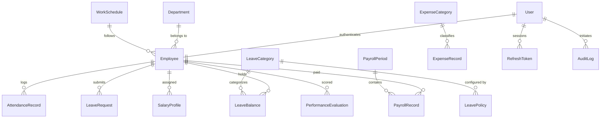

# Database Design & Schemas — AIExpertsBD Attendance Tracker

## 1. Overview & Data Integrity Principles

The Attendance Tracker database is modeled in MongoDB using Mongoose with the following core rules:

1. **Integer Minor Currency Units**:
   All monetary amounts (Base Salary, Gross Earnings, Deductions, Bonuses, Net Payable, Office Expenses) are stored in integer **paisa** ($1\text{ BDT} = 100\text{ paisa}$). This prevents all IEEE 754 floating-point inaccuracies.
2. **UTC Timestamp Normalization**:
   All calendar dates and actual check-in/out timestamps are stored in UTC. Calculations convert to the company's operating timezone (`Asia/Dhaka`, UTC+6) before evaluating day boundaries.
3. **Compound Unique Indexes**:
   - `AttendanceRecord`: `{ employee: 1, date: 1 }` prevents duplicate daily attendance for the same staff.
   - `LeaveBalance`: `{ employee: 1, leaveCategory: 1, year: 1 }` prevents duplicate balance records.
   - `PayrollPeriod`: `{ month: 1, year: 1 }` enforces single payroll batch per calendar month.
   - `PayrollRecord`: `{ payrollPeriod: 1, employee: 1 }` ensures an employee cannot be paid twice in the same batch.
   - `PerformanceEvaluation`: `{ employee: 1, month: 1, year: 1 }` guarantees one evaluation per month.
4. **Historical Immutability & Snapshots**:
   When a `PayrollPeriod` is finalized, complete snapshots (`policySnapshot`, `salarySnapshot`, `attendanceSnapshot`) are frozen within each `PayrollRecord`. Future modifications to company policies never alter finalized historical records.
5. **Auditable Leave Ledger**:
   Leave balances are updated alongside atomic `LeaveLedgerEntry` records (`allocation`, `deduction`, `cancellation`, `accrual`), providing an auditable trail that prevents balance leakage or double deductions.

---

## 2. Entity Relationship Summary

---

## 3. Core Models Specification

### User (`User.ts`)
- `employeeId`: ObjectId (Ref: Employee, unique)
- `email`: String (lowercase, unique)
- `passwordHash`: String (bcrypt hash, `select: false`)
- `role`: Enum (`super_admin`, `hr_admin`, `employee`)
- `isActive`: Boolean (default true)
- `loginAttempts`: Number (lockout counter)
- `lockUntil`: Date (account lockout timer)

### Employee (`Employee.ts`)
- `employeeCode`: String (e.g. `AIE-001`, unique, uppercase)
- `firstName`, `lastName`: String
- `email`: String (unique)
- `phone`: String
- `department`: ObjectId (Ref: Department)
- `designation`: String
- `joiningDate`: Date
- `employmentType`: Enum (`full_time`, `part_time`, `contract`, `intern`)
- `employmentStatus`: Enum (`active`, `suspended`, `terminated`, `on_notice`)
- `workSchedule`: ObjectId (Ref: WorkSchedule)
- `attendancePolicy`: ObjectId (Ref: AttendancePolicy)

### AttendanceRecord (`AttendanceRecord.ts`)
- `employee`: ObjectId (Ref: Employee)
- `date`: Date (normalized to UTC start of day)
- `scheduledStartTime`, `scheduledEndTime`: Date
- `actualCheckInTime`, `actualCheckOutTime`: Date
- `lateMinutes`: Number
- `lunchOutTime`, `lunchInTime`: Date
- `lunchDurationMinutes`: Number
- `netWorkingMinutes`: Number
- `status`: Enum (`present`, `late`, `half_day`, `absent`, `on_leave`, `holiday`, `weekly_off`, `in_progress`)
- `approvalStatus`: Enum (`auto_approved`, `pending`, `approved`, `rejected`)
- `isManualEntry`: Boolean
- `correctionReason`: String

### PayrollRecord (`PayrollRecord.ts`)
- `payrollPeriod`: ObjectId (Ref: PayrollPeriod)
- `employee`: ObjectId (Ref: Employee)
- `baseSalary`: Number (paisa)
- `workingDays`: Number
- `daysPresent`, `daysAbsent`, `halfDays`, `lateDays`: Number
- `grossEarnings`: Number (paisa)
- `absentDeductions`, `halfDayDeductions`, `lateDeductions`: Number (paisa)
- `performanceBonus`: Number (paisa)
- `netPayable`: Number (paisa)
- `status`: Enum (`draft`, `approved`, `finalized`)
- `policySnapshot`, `salarySnapshot`, `attendanceSnapshot`: Mixed (frozen inputs)
